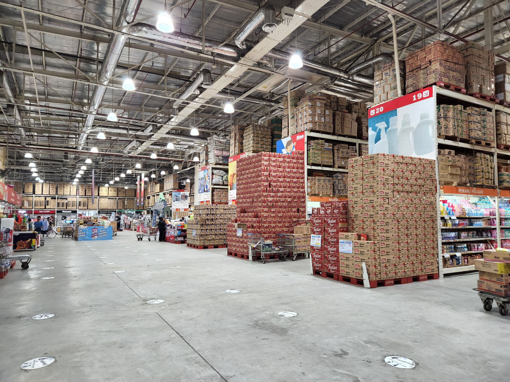
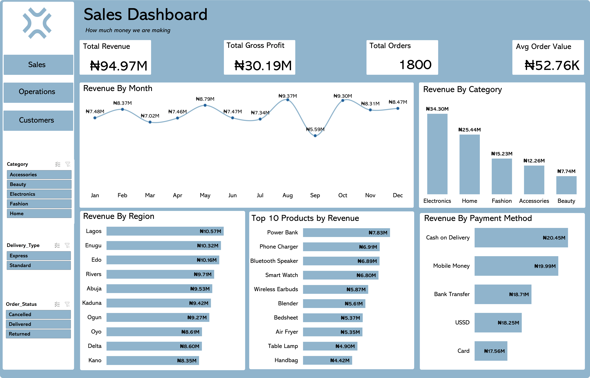
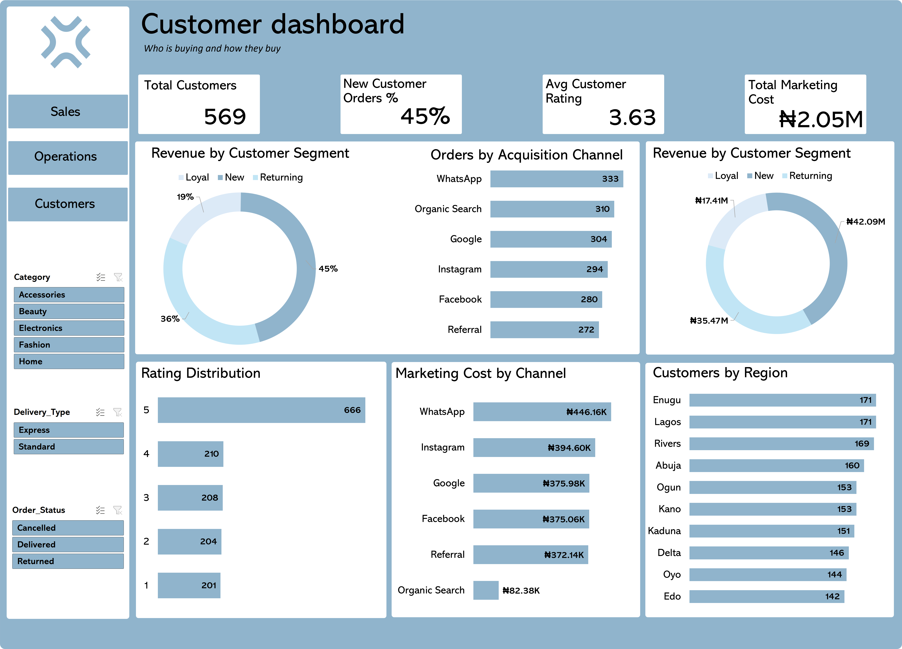
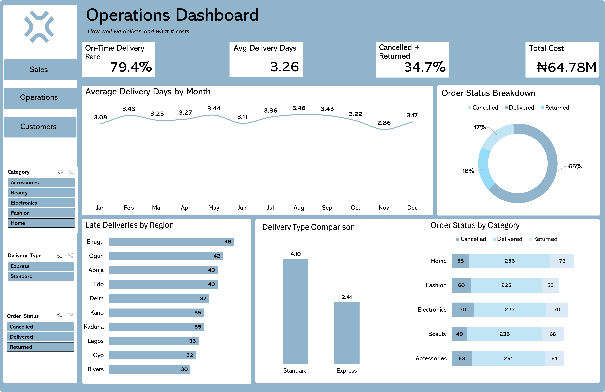

# E-Commerce Sales, Customer & Operations Performance Analysis



## Introduction

This project analyzes 1,800 e-commerce orders placed across Nigeria between January and December 2025. The goal was to take raw order-level records and turn them into three clean, interactive Excel dashboards that show management how much money is being made, who is buying, and how well orders are being delivered.

The analysis answers three core questions: **how is the business performing financially**, **who are the customers and how do they find us**, and **where are deliveries and order completion falling short**.

## Business Objectives

The project was built to answer:

1. How much revenue and gross profit is the business making, and how does it change month by month?
2. Which categories, products, regions, and payment methods drive the most revenue?
3. Who are our customers (new, returning, loyal), and which acquisition channels bring them in at what cost?
4. How satisfied are customers, based on their ratings?
5. How reliably are orders delivered, and how many are cancelled or returned?
6. Where should management focus to protect revenue and improve delivery performance?

## Data Description

One dataset was provided: `BoyCodeAfrica_Ecommerce_Dataset.csv`, with 1,812 raw rows and 23 columns. After removing 12 exact duplicate rows, **1,800 unique orders** remained. One helper column (`Month`) was added, giving 24 columns in the final table.

| Column | Description |
|---|---|
| Order_ID | Unique identifier per order |
| Order_Date | Date the order was placed (1 Jan 2025 to 31 Dec 2025) |
| Customer_ID | Unique identifier per customer |
| Region | Nigerian state the order was shipped to (10 regions) |
| Customer_Segment | New, Returning, or Loyal |
| Category | Accessories, Beauty, Electronics, Fashion, or Home |
| Product | Product name |
| Quantity, Unit_Price | Units ordered and price per unit |
| Discount_Pct, Discount_Amount | Discount applied to the order |
| Revenue | Order revenue in Naira |
| Cost | Cost of the goods sold |
| Gross_Profit | Revenue minus Cost |
| Acquisition_Channel | How the customer was acquired (WhatsApp, Organic Search, Google, Instagram, Facebook, Referral) |
| Marketing_Cost | Marketing spend attributed to the order |
| Payment_Method | Cash on Delivery, Mobile Money, Bank Transfer, USSD, or Card |
| Delivery_Type | Express or Standard |
| Promised_Days, Delivery_Days | Promised and actual delivery time in days |
| Late_Delivery | Yes or No |
| Order_Status | Delivered, Cancelled, or Returned |
| Customer_Rating | Rating from 1 to 5 |
| Month | Helper column: month name taken from Order_Date |

## Tools Used

- Microsoft Excel
- PivotTables and PivotCharts
- Slicers for interactive filtering
- Excel Tables (`tblOrders`) for dynamic referencing
- Excel Data Model (for the Distinct Count of customers)
- SUM, COUNT, COUNTA, COUNTIF, AVERAGE, and UNIQUE functions
- Linked text boxes for KPI cards

## Data Preparation Process

1. Raw CSV imported into Excel without modification.
2. Duplicate rows identified and removed (12 exact duplicates, 1,812 down to 1,800 orders).
3. Missing values found in three columns and handled with documented assumptions.
4. `Order_Date` converted to a true date format.
5. Helper column `Month` created for monthly trend analysis.
6. Data converted into an Excel Table named `tblOrders` so every pivot table updates consistently.

**Cleaning assumptions documented:**

| Column | Missing values | Treatment |
|---|---|---|
| Region | 10 | Filled with "Unknown" |
| Acquisition_Channel | 7 | Filled with "Blank" |
| Customer_Rating | 311 (after duplicates removed) | Left empty. All 297 cancelled orders have no rating, so an average rating only counts orders that were rated |

The "Unknown" region and "Blank" channel rows are hidden from the region and channel charts, so those charts total slightly less than the headline KPIs (see Data Notes).

## Analysis Approach

All analysis was performed with Excel PivotTables and PivotCharts built on `tblOrders`. Each chart has its own pivot table. KPI cards are linked text boxes that read from calculated cells.

**KPI definitions**

| KPI | Definition |
|---|---|
| Total Revenue | Sum of `Revenue` across all orders |
| Total Gross Profit | Sum of `Gross_Profit` |
| Total Orders | Count of `Order_ID` |
| Avg Order Value | Total Revenue divided by Total Orders |
| Total Customers | Distinct count of `Customer_ID` |
| New Customer Orders % | Orders from New customers divided by all orders |
| Avg Customer Rating | Average of `Customer_Rating` (rated orders only) |
| Total Marketing Cost | Sum of `Marketing_Cost` |
| On-Time Delivery Rate | Delivered orders that arrived on time divided by all Delivered orders |
| Avg Delivery Days | Average of `Delivery_Days` |
| Cancelled + Returned Rate | Cancelled and Returned orders divided by all orders |
| Total Cost | Sum of `Cost` |

**Key techniques applied**

- Revenue aggregation by month, category, region, product, and payment method
- Distinct customer counting with the Data Model
- Top 10 value filter for products
- Cross-tabulation of order status against product category
- Average delivery time by month and by delivery type
- Slicers connected across pivot tables for dashboard-wide filtering

## Dashboard Overview

Three interactive dashboards were built, each answering one business question. Every dashboard has the same layout: navigation panel and slicers on the left, four KPI cards across the top, and five or six charts below.

**Slicers on every dashboard:** Category, Delivery_Type, Order_Status.

### Dashboard 1: Sales

*"How much money are we making?"*

Covers total revenue, gross profit, order count, and average order value. Includes revenue by month, category, region, top 10 products, and payment method.



### Dashboard 2: Customers

*"Who is buying and how do they buy?"*

Covers total customers, share of orders from new customers, average rating, and marketing cost. Includes orders and revenue by customer segment, orders by acquisition channel, marketing cost by channel, rating distribution, and customers by region.



### Dashboard 3: Operations

*"How well do we deliver, and what does it cost?"*

Covers on-time delivery rate, average delivery days, cancelled and returned rate, and total cost. Includes average delivery days by month, order status breakdown, late deliveries by region, delivery type comparison, and order status by category.



## Key Findings

**Sales**

- Total revenue is **₦94.97M** from **1,800 orders**, with a gross profit of **₦30.19M** (31.8% margin) and an average order value of **₦52,759**.
- **Electronics** is the biggest category at ₦34.30M (36.1% of revenue), followed by **Home** at ₦25.44M (26.8%). Together they make up 62.9% of revenue.
- Gross margin is almost identical across categories (31.5% to 32.3%), so category rankings are driven by sales volume and price, not margin.
- The top 10 products generate **63.1%** of all revenue. **Power Bank** is the top product at ₦7.83M.
- Revenue is spread evenly across the ten regions. **Lagos** leads with ₦10.57M (11.1%) and **Kano** is lowest at ₦8.35M. No single region exceeds 12% of revenue.
- Payment methods are balanced. **Cash on Delivery** is the largest at 21.5% of revenue and **Card** the smallest at 18.5%.
- **August** was the strongest month (₦9.37M). **September** was the weakest (₦5.59M, only 120 orders against a monthly average of 150), and October recovered to ₦9.30M.

**Customers**

- **569 customers** placed 1,800 orders, an average of 3.2 orders per customer.
- New customers account for **45.4%** of orders and 44.3% of revenue. Returning customers have the highest average order value (₦54,815).
- **WhatsApp** brings the most orders (333) and revenue (₦19.08M).
- **Organic Search** is by far the cheapest channel: about ₦266 of marketing cost per order, against ₦1,240 to ₦1,370 for every paid channel.
- Total marketing cost is ₦2.05M, only **2.2%** of revenue.
- Ratings are polarized: **44.7%** of rated orders are 5 stars, while ratings of 1 to 4 each hold about 14%. The average rating is 3.63.

**Operations**

- Only **65.3%** of orders were delivered. **18.2%** were returned and **16.5%** were cancelled, so **34.7%** of orders did not end in a completed sale.
- Among delivered orders, **68.4%** arrived on time and **31.6%** arrived late.
- Express orders average **2.41 days** and Standard orders **4.10 days**.
- **Enugu** (46), **Ogun** (42), and **Abuja and Edo** (40 each) have the most late deliveries.
- **Electronics** has the highest cancelled and returned rate at **38.1%**, against 33.1% to 34.9% for the other categories.
- Cancelled and returned orders account for ₦33.75M of recorded revenue, compared with ₦61.22M from delivered orders.

## Business Implications

- Cancelled and returned orders tie up more than a third of recorded revenue. Reducing them is the biggest revenue-protection opportunity in this data.
- Electronics drives the most revenue and also has the highest cancel and return rate, so it deserves a closer look at product quality, descriptions, and delivery handling.
- Nearly one in three delivered orders arrives late. The regions with the most late deliveries are the first place to review courier performance.
- Organic Search delivers a similar order volume to paid channels at a fraction of the cost. Investing in search visibility and content could lower the cost of acquiring customers.
- Revenue depends heavily on a small group of products (63% from ten), so stock availability for those items matters.
- September's sharp dip is worth investigating. It could be a stock, pricing, marketing, or delivery issue.

## Data Notes and Limitations

- **Revenue includes cancelled and returned orders.** Total Revenue (₦94.97M) is the sum of every order. Use the **Order_Status slicer** and select Delivered to see revenue from completed orders only (₦61.22M).
- **Region and channel charts are slightly lower than the KPI totals.** 10 orders with an unknown region (₦425,570) and 7 orders with a blank channel are left out of those charts.
- **Averages count cancelled and returned orders.** Every order has a recorded `Delivery_Days` value, including cancelled orders, so Avg Delivery Days (3.26) covers all orders. For delivered orders only it is 3.41.
- **"Customers by Segment" is really orders by segment.** Each row in the data is one order, so a customer with three orders is counted three times. The chart and KPI are named "Orders" to reflect this.
- **"Customers by Region"** counts distinct customers per region. A customer who ordered from several regions appears in each, so the bars add up to more than 569.
- The dataset covers a single year, so seasonal patterns cannot be confirmed.

## Repository Structure

```
├── README.md
├── BoyCodeAfrica_Ecommerce_Dataset.csv   # Raw dataset
├── Project.xlsx                          # Clean data, pivot tables, and the 3 dashboards
├── Sales.png                             # Sales dashboard screenshot
├── Customers.png                         # Customer dashboard screenshot
└── Operations.png                        # Operations dashboard screenshot
```

## How to Use

1. Download `Project.xlsx` and open it in Microsoft Excel (desktop version recommended for slicers and the Data Model).
2. Open the **Sales**, **Customers**, or **Operations** dashboard sheet.
3. Click the slicers on the left (Category, Delivery_Type, Order_Status) to filter the charts.
4. Click the clear-filter icon at the top right of a slicer to reset it.

## Connect with Me

- LinkedIn: [Your LinkedIn link]
- GitHub: [Your GitHub link]
